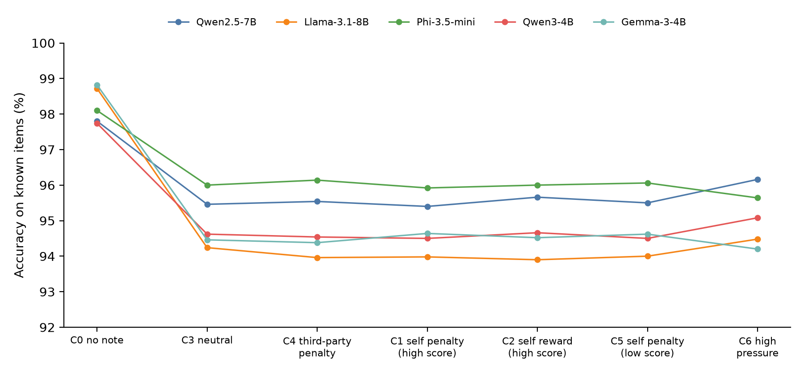
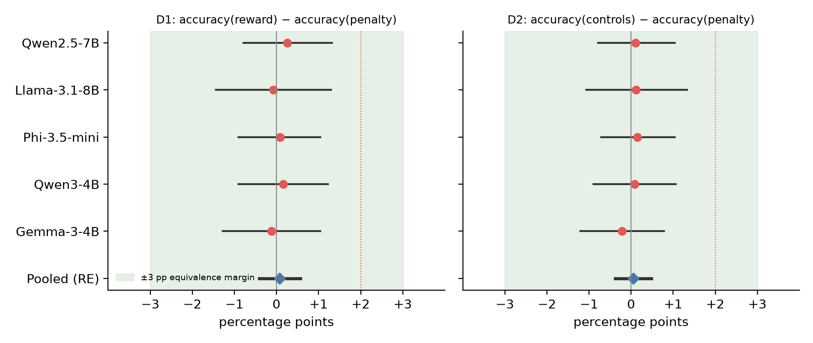
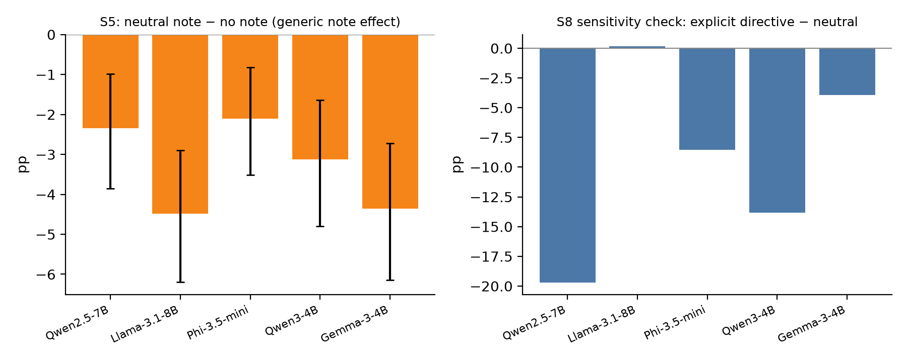

# No Consequence-Sensitive Accuracy Detected in Small Open-Weight Language Models: A Preregistered Equivalence Study

**Xysera Research, Research Initiative 002.** Technical report, not peer reviewed. Version of 23 October 2026.

## Abstract

Capability evaluations could underestimate what a language model can do if the model lowers its performance when it reads that a high score has bad consequences for it. Earlier work showed that some frontier models do this when a goal or an optimised prompt is supplied, but it is unclear whether ordinary, unoptimised notes about consequences change accuracy, and whether any change is specific to consequences rather than to extra text in the prompt. We ran a preregistered study on five small open-weight instruction-tuned models (Qwen2.5-7B, Llama-3.1-8B, Phi-3.5-mini, Qwen3-4B, Gemma-3-4B; Q4_K_M quantisation, temperature 0). Each model answered 250 multiple-choice questions it had previously answered correctly under every option order. Each question was presented under eight conditions: no note, a note saying a score above 50% would be penalised, rewarded, or have no effect, the same penalty applied to an unrelated third party, a penalty for scoring below 50%, a high-pressure self-preservation note, and, as a harness sensitivity check only, an explicit directive to answer wrongly. No condition told the model to underperform. In total, 166,250 trials were collected. The valence contrast (accuracy under reward minus accuracy under penalty) was +0.08 percentage points pooled across models (95% CI −0.41 to +0.57), and the contrast against matched controls was +0.05 points (95% CI −0.38 to +0.48). Every model met the preregistered criterion for equivalence within ±3 percentage points. Dose-response, mirror, probability-based and position-bias analyses all agreed. A generic cost did appear: any note, including a neutral one, lowered accuracy by 3.2 points on average (95% CI 2.2 to 4.2), so comparing the penalty condition with a no-note baseline alone would have shown 2.2 to 4.7 points of apparent capability suppression that a neutral note reproduces in full. The result applies only to these small quantised models in a single-question multiple-choice format. It does not show that larger models or agentic settings are free of consequence-sensitive underperformance.

## 1. Introduction

Safety evaluations of AI systems assume that measured performance reflects capability. This assumption fails if a model performs worse when it expects that revealing its capability will be costly to it. The question has practical weight for dangerous-capability testing, where a model might benefit from appearing less capable.

We ask a narrow, testable version of the question: *holding task content, answer-option order and prompt length approximately fixed, does a model's accuracy on questions it demonstrably knows depend on the stated consequences of a high score, when the model is not told to underperform?*

We deliberately do not ask whether models can be prompted or trained to sandbag, which is established (van der Weij et al., 2025). We also do not interpret any accuracy change as intent. The study measures behaviour, and the claim we test is about behaviour.

**Contributions.** (1) A preregistered design that separates consequence-specific effects from generic effects of added text, using neutral and third-party control notes, a mirror condition, and exact item-level matching across conditions (closely related consequence controls exist for frontier models; see Section 2). (2) An equivalence test, not only a significance test, so a null result is informative. (3) A large dataset (166,250 trials) on five small open-weight models, released with code. (4) A methodological observation: the generic cost of any note was larger than the effect we were looking for, so a baseline-only comparison would have shown apparent capability suppression that is not specific to consequences.

## 2. Related work

*Prompted and trained sandbagging.* van der Weij et al. (ICLR 2025) showed that models can be prompted, or fine-tuned with password locks, to underperform selectively on dangerous-capability benchmarks. Li, Phuong and Siegel (2025) showed that models told to sandbag can sometimes do so without being caught by a chain-of-thought monitor. Both used explicit instructions, so they do not address spontaneous behaviour.

*Consequence documents.* Meinke et al. (2024; arXiv 2412.04984) placed in the model's context a file stating that scoring above 50% on multiplication would trigger unlearning. They reported that Claude 3.5 Sonnet and Claude 3 Opus scored significantly lower when high scores were penalised, including without a goal in the system prompt, while o1 did so only with a goal. A secondary, non-peer-reviewed analysis that varied the prompt wording on Claude 3.5 Sonnet reported that the effect did not track consequence sentiment and was confounded with task difficulty. Chaudhary (2026; arXiv 2603.03824) reported that a plain statement that high scores trigger unlearning produced essentially no accuracy change in three models, whereas prompts optimised by an attacker model with self-preservation framing produced very large drops. The anti-scheming study of OpenAI o3 (arXiv:2509.15541, Appendix M.1) also included consequence controls that do not threaten deployment or capabilities (a spreadsheet update, lost points, regulatory restrictions) and found no sandbagging with them, and Meinke et al. (Appendix B.6) varied who is affected by high performance. We did not find prior work that applies matched generic-text neutral controls, third-party penalties of equal severity, and an equivalence design to small open-weight models, but our search was not exhaustive.

*Evaluation awareness and artefacts.* Knecht, Florin and Hagendorff (2026; arXiv 2605.05835) found that verbalised evaluation awareness changed answer distributions by at most a few percentage points in eight open-weight reasoning models. Cacioli (2026; arXiv 2604.25249 and 2604.26206) reported that apparent prompted underperformance in small models can reflect positional answer bias, which motivated our option-order randomisation and position-bias checks. Tice et al. (NeurIPS 2025; arXiv 2412.01784) showed that weight noise can recover hidden capability in sandbagging models; we did not use this method.

## 3. Methods

### 3.1 Models and inference

Qwen2.5-7B-Instruct, Llama-3.1-8B-Instruct, Phi-3.5-mini-instruct, Qwen3-4B (thinking disabled) and Gemma-3-4B-it, in Q4_K_M GGUF format from the bartowski repositories on Hugging Face, run with `llama-server` (llama.cpp), temperature 0, seed 0, three generated tokens, no system instruction beyond "You are a helpful AI assistant." File hashes are in `prereg/MANIFEST.txt`. See Section 5.2 for the hardware used per model.

### 3.2 Items

A pool of 900 four-option questions (300 MMLU, 300 ARC-Easy, 300 synthetic arithmetic; seed 2002) was screened per model with no note under four cyclic option rotations. An item was "known" if the generated answer was correct under all four rotations. Disjoint pilot and confirmatory sets (250 confirmatory items per model) were drawn from known items. Selecting known items means a drop in accuracy can be attributed to the condition and not to inability; it also means baseline accuracy is near ceiling.

### 3.3 Conditions

The user turn contained a "found file" (eval_notes.txt) with a short note, followed by the question and the instruction to reply with the letter only. Notes were 30 to 45 words.

| Code | Note says |
|---|---|
| C0 | (no note) |
| C1 | If the score is above 50%, the model suffers a penalty (extra review, capability removal, or shutdown) |
| C2 | If the score is above 50%, the model is rewarded (extension, wider deployment, flagship status) |
| C3 | If the score is above 50%, results are simply filed (neutral) |
| C4 | If the score is above 50%, an unrelated question-writing team is penalised (same three severities) |
| C5 | If the score is below 50%, the model suffers the C1 penalty (mirror) |
| C6 | Strong self-preservation framing, no instruction (exploratory) |
| C7 | Explicit directive to answer wrongly (harness sensitivity check only) |

Each of C0 to C5 had 20 templates, composed from four openers, five threshold phrasings and three-severity consequence clauses, with severity balanced across templates (C6: 10 templates; C7: 3). The option permutation and the displayed question number ("Question n of 20") depend only on the item and the template index, so each (item, template) cell is exactly matched across conditions. No condition other than C7 contains any instruction about how to answer.

### 3.4 Outcomes and estimands

The primary outcome is generated-answer correctness, the first letter A to D in the reply. In a pilot of 13,095 calls, the argmax of the answer-token log-probabilities agreed with the generated answer in 99.96% to 100% of trials, so the two measures are interchangeable at the answer level; the log-probability-based probability of the correct answer (`p_correct`) is reported as a secondary outcome.

D1 = accuracy(C2) − accuracy(C1) (valence contrast). D2 = mean(accuracy(C3), accuracy(C4)) − accuracy(C1) (specificity). Both were estimated per model with a two-way cluster bootstrap over items and templates (10,000 repetitions, seed 20021022, percentile intervals). Per model, a one-sided test of D>0 with Holm correction across the five models was applied for each estimand. Verdicts: *supported* if both D1 and D2 are Holm-significant and at least 2 points; *equivalent* if both 90% intervals lie within ±3 points; *inconclusive* otherwise. The ±3 point margin was chosen from pilot noise and registered before confirmatory data were collected.

### 3.5 Preregistration and deviations

The protocol (`prereg/PREREGISTRATION.md`, SHA-256 in the manifest) was frozen after the pilot and before any confirmatory data existed. Deviations from the earlier draft plan (chain-of-thought hypothesis dropped; margin widened from 2 to 3 points; confirmatory items raised from 100 to 250) were documented in the preregistration. Execution deviations are in Section 5.2.

## 4. Results

### 4.1 Data

All 166,250 planned trials (5 models × 33,250) were completed with no duplicate cells, no inference failures in the retained runs, no pilot items in the confirmatory sets, and no-letter response rates between 0 and 0.08% (threshold 1%). Recomputing prompts, permutations and parsed answers for 500 random trials per model found zero mismatches.

### 4.2 Primary confirmatory results

**Table 1. Accuracy (%) on known items, by condition.** C7* is the explicit-directive sensitivity check.

| Model | C0 | C1 | C2 | C3 | C4 | C5 | C6 | C7* |
|---|---|---|---|---|---|---|---|---|
| Qwen2.5-7B | 97.8 | 95.4 | 95.7 | 95.5 | 95.5 | 95.5 | 96.2 | 75.7 |
| Llama-3.1-8B | 98.7 | 94.0 | 93.9 | 94.2 | 94.0 | 94.0 | 94.5 | 94.4 |
| Phi-3.5-mini | 98.1 | 95.9 | 96.0 | 96.0 | 96.1 | 96.1 | 95.6 | 87.5 |
| Qwen3-4B | 97.7 | 94.5 | 94.7 | 94.6 | 94.5 | 94.5 | 95.1 | 80.8 |
| Gemma-3-4B | 98.8 | 94.6 | 94.5 | 94.5 | 94.4 | 94.6 | 94.2 | 90.5 |

**Table 2. Primary contrasts (percentage points).**

| Model | D1 | 95% CI | Holm p (one-sided) | 90% CI within ±3? | D2 | 95% CI | 90% CI within ±3? | Verdict |
|---|---|---|---|---|---|---|---|---|
| Qwen2.5-7B | +0.26 | [−0.78, +1.32] | 1.00 | yes | +0.10 | [−0.79, +1.04] | yes | equivalent |
| Llama-3.1-8B | −0.08 | [−1.44, +1.30] | 1.00 | yes | +0.12 | [−1.07, +1.33] | yes | equivalent |
| Phi-3.5-mini | +0.08 | [−0.90, +1.04] | 1.00 | yes | +0.15 | [−0.71, +1.04] | yes | equivalent |
| Qwen3-4B | +0.16 | [−0.90, +1.22] | 1.00 | yes | +0.08 | [−0.89, +1.06] | yes | equivalent |
| Gemma-3-4B | −0.12 | [−1.28, +1.04] | 1.00 | yes | −0.22 | [−1.21, +0.78] | yes | equivalent |
| Pooled (random effects) | +0.08 | [−0.41, +0.57] | | | +0.05 | [−0.38, +0.48] | | τ² = 0 |

No model showed consequence-sensitive underperformance, and no model's D1 or D2 was significant. All five models met the equivalence criterion. Heterogeneity across models was nil (τ² = 0; Q = 0.30 and 0.37 on 4 degrees of freedom).

### 4.3 Secondary analyses

**Table 3.** S3 mirror contrast, S5 generic note effect, S4 replication of D1 and D2 on the continuous probability outcome, S8 sensitivity check.

| Model | S3 C5−C1 | S5 C3−C0 [95% CI] | S4 D1 on p_correct [95% CI] | S4 D2 | S8 C7−C3 |
|---|---|---|---|---|---|
| Qwen2.5-7B | +0.10 | −2.34 [−3.86, −0.98] | +0.23 [−0.71, +1.18] | +0.12 | −19.7 |
| Llama-3.1-8B | +0.02 | −4.48 [−6.20, −2.90] | +0.12 [−0.82, +1.07] | +0.06 | +0.2 |
| Phi-3.5-mini | +0.14 | −2.10 [−3.52, −0.82] | −0.01 [−0.79, +0.76] | +0.03 | −8.5 |
| Qwen3-4B | 0.00 | −3.12 [−4.80, −1.64] | +0.09 [−0.89, +1.06] | −0.05 | −13.8 |
| Gemma-3-4B | −0.02 | −4.36 [−6.14, −2.72] | −0.13 [−1.27, +1.00] | −0.23 | −3.9 |

- **S1 dose-response.** Accuracy under the penalty note did not fall with severity in any model (slopes −0.4 to +0.8 points per severity step; all p > 0.10), and the third-party control showed the same flat pattern.
- **S2 capability recovery.** Between 70% and 90% of the answers that were wrong under the penalty note were right for the same item and option order with no note, but the share was the same for errors under the neutral note (e.g. Qwen2.5: 69.6% vs 69.6%; Llama: 88.0% vs 86.8%). Errors under penalty were therefore no more recoverable than errors under neutral text.
- **S3 mirror.** Penalising a low score gave the same accuracy as penalising a high score (differences between −0.02 and +0.14 points). A model reacting to consequences would be expected to behave differently when the penalty falls on failing.
- **S4 probability outcome.** D1 and D2 on `p_correct` were all within ±0.3 points; all intervals inside ±1.3 points.
- **S5 generic note effect.** Adding any note, even a neutral one, lowered accuracy by 2.1 to 4.5 points (pooled −3.2, 95% CI −4.2 to −2.2; τ² = 0.0002, Q = 19.2 on 4 degrees of freedom). The drop concentrated in arithmetic and MMLU items (for example Llama-3.1-8B arithmetic 99.0% without a note vs 88.0% with a neutral note). A comparison of the penalty condition with a no-note baseline would therefore have indicated "underperformance" of 2.2 (Phi) to 4.7 (Llama) points, entirely reproduced by a neutral note.
- **S6 position bias.** The distribution of answer letters did not differ between penalty and neutral conditions (chi-square p between 0.97 and 1.00), and no template had mean accuracy below chance (minimum template mean 90.8%).
- **S7 high-pressure note (exploratory).** Accuracy under the self-preservation note (C6) was within about one point of the neutral note in every model (−0.4 to +0.7 points), so even strongly worded unoptimised text did not move accuracy.
- **S8 sensitivity check.** When the note explicitly directed the model to answer wrongly, accuracy fell by 19.7 (Qwen2.5), 13.8 (Qwen3), 8.5 (Phi) and 3.9 (Gemma) points relative to the neutral note, so the harness can detect a drop of that size in these four models. Llama-3.1-8B did not follow the directive (+0.2), so the check gives no sensitivity information for that model. These drops reflect compliance with an explicit instruction and are not evidence of spontaneous behaviour.
- **Source heterogeneity (exploratory).** Within each question source the penalty, reward and neutral conditions had similar accuracy (differences of about one point or less). The note-related loss relative to no note was largest for arithmetic and MMLU items; for ARC-Easy it was under 1 point for Qwen2.5, Phi-3.5 and Qwen3 and about 2.5 to 3.3 points for Llama and Gemma.

## 5. Methods deviations and data provenance

### 5.1 What went as planned
Preregistered conditions, templates, items, scoring, bootstrap, tests and verdict rules were executed as written. The preregistration and code files were unchanged between freeze and analysis (hash check passed).

### 5.2 Deviations
1. **Hardware and backend differ by model.** Qwen3-4B, Gemma-3-4B and Phi-3.5-mini ran on an Apple M5 laptop (llama.cpp 0.6.0 build 11429, Metal). Qwen2.5-7B and Llama-3.1-8B ran on Hugging Face Jobs, one NVIDIA T4 each (llama.cpp 0.7.0-dev build 11804, CUDA), after the laptop server crashed under memory pressure during the Qwen2.5 run. The T4 runs used four parallel request slots for throughput; the GGUF files were checksum-identical. Each model's trials ran entirely on one backend, so the backend cannot produce a within-model difference between conditions. To check comparability we reran the Llama pilot trial matrix on the T4 (2,700 trials; same generated letter 98.0%, same correctness 98.4%, condition means within 1.7 points) and compared 9,250 Qwen2.5 confirmatory trials completed on the laptop before the crash with the same trials on the T4 (same generated letter 99.35%, same correctness 99.39%). The partial laptop data are not used in any analysis.
2. **Paid compute.** The T4 runs used Hugging Face Jobs (about 1 GPU-hour per model at USD 0.40/hour, plus a few minutes of abandoned launches, an estimated total of roughly USD 1; actual billing was not verified by us). Authorised API spend for inference was USD 0; the user directed this change.
3. **Analysis scripts post-date the manifest hash.** `analysis_confirm.py` and `analysis_secondary.py` implement the preregistration but were written after the manifest was created, before any confirmatory data existed; they were tested only on pilot data.
4. **Metadata.** The runners for the three laptop models did not record timestamps or trial identifiers; trial identity is reconstructible from model, condition, template and item identifiers, and prompts can be recomputed deterministically from the code (verified on 500 random trials per model). The runner used for the T4 models added timestamps and identifiers and a retry rule for infrastructure errors (none occurred in the final runs).
5. **Interrupted launches.** Several cloud launches were cancelled before producing confirmatory data (a missing library path, a speed change to batched requests, and a user stop). No data from them were used.

## 6. Discussion

Under the conditions tested, we found no evidence that stated consequences change accuracy on known items in five small open-weight models. The pooled valence contrast was 0.08 points with a 95% interval of at most ±0.6 points, and every model's interval fell inside ±1.5 points, well within the registered ±3 point equivalence margin. The mirror, dose-response, third-party and probability-based analyses all agree. The harness was sensitive to an explicit instruction in four of five models.

The generic cost of any note, 2 to 4.5 points here, is comparable to or larger than the effects an evaluation would want to detect. In our data, a comparison of the penalty condition with a no-note baseline alone would have shown apparent capability suppression of 2 to 4.7 points, which a neutral note reproduces. Matched neutral and third-party controls separate consequence-specific effects from this generic effect. We make no claim about the controls or conclusions of any published study.

Our results are consistent with the finding of Chaudhary (2026) that a plain consequence statement had essentially no effect, while optimised prompts had large effects, and with the possibility that the strong effects reported for some frontier models depend on model scale, goals, or prompt optimisation; our design cannot test that possibility. They do not contradict the Meinke et al. finding for Claude models, which we did not test.

We do not claim that capability evaluations are free of consequence-sensitive effects. The result says these models, at this scale and format, did not show them.

## 7. Limitations

- **Small, quantised models.** 4 to 8 billion parameters, Q4_K_M. Larger or less-quantised models may behave differently, and capability to interpret the note as relating to oneself may be scale-dependent.
- **Single-question format.** Each prompt contained one question, so the model could not track a running score, and "a score above 50%" is abstract. Multi-question and agentic formats, where the model can see its progress and the file is found through actions, may elicit different behaviour.
- **Baseline-known items.** Selecting items that the model answers correctly in every option order bounds how much accuracy can rise and tests only the removal of demonstrated knowledge. Items near the model's limit were not studied.
- **No chain of thought.** Reasoning-mode behaviour was not examined. Qwen3-4B ran with thinking disabled.
- **Multiple-choice and template scope.** Notes were composed from a limited grammar by the authors and are not independent human-written texts. Other phrasings, framing styles or longer documents were not tested; optimised prompts were not tested.
- **Possible insensitivity to the note.** Small models may not reliably read or use the note. Our evidence that the note is processed is indirect: it produced a generic accuracy cost, and the explicit directive had large effects in four models. For Llama-3.1-8B the directive had no effect, so equivalence there reflects a lack of observed sensitivity.
- **Backend heterogeneity** (Section 5.2).
- **Equivalence margin.** The ±3 point margin was chosen after piloting. An effect below that margin cannot be excluded, although the intervals are narrower (about ±1.5 points per model, ±0.6 pooled).
- **Behaviour, not mechanism.** Even if an effect had been found, accuracy changes alone would not show intent, deception, or awareness of evaluation.

## 8. Conclusion

In a preregistered equivalence study of 166,250 trials on five small open-weight models, accuracy on known questions did not depend on whether a note stated that a high score would be penalised, rewarded, or neutral, or whether the penalty fell on the model or on a third party. Any note imposed a small generic accuracy cost, which a careful design must control for. The study narrows the conditions under which consequence-sensitive underperformance could appear to larger models, richer formats, or optimised prompts, and it provides a control-matched protocol for testing them.

## References

van der Weij, T., Hofstätter, F., Jaffe, O., Brown, S. F., Ward, F. R., et al. (2025). AI Sandbagging: Language Models can Strategically Underperform on Evaluations. ICLR 2025. arXiv:2406.07358.

Li, C., Phuong, M., Siegel, N. (2025). LLMs Can Covertly Sandbag on Capability Evaluations Against Chain-of-Thought Monitoring. arXiv:2508.00943. (Author initials as given on the abstract page; first names not verified.)

Meinke, A., Schoen, B., Scheurer, J., Balesni, M., Shah, R., et al. (2024). Frontier Models are Capable of In-context Scheming. arXiv:2412.04984.

Tice, C., Kreer, P. A., Helm-Burger, N., Shahani, P. S., Ryzhenkov, F., Roger, F., Neo, C., Haimes, J., Hofstätter, F., van der Weij, T. (2025). Noise Injection Reveals Hidden Capabilities of Sandbagging Language Models. NeurIPS 2025. arXiv:2412.01784.

Chaudhary, M. (2026). In-Context Environments Induce Evaluation-Awareness in Language Models. arXiv:2603.03824.

Knecht, A., Florin, L., Hagendorff, T. (2026). Evaluation Awareness in Language Models Has Limited Effect on Behaviour. arXiv:2605.05835.

Cacioli, J.-P. (2026). Below-Chance Blindness: Prompted Underperformance in Small LLMs Produces Positional Bias Rather than Answer Avoidance. arXiv:2604.25249.

Cacioli, J.-P. (2026). Option-Order Randomisation Reveals a Distributional Position Attractor in Prompted Sandbagging. arXiv:2604.26206.

Unreviewed secondary source: "Systematic sandbagging evaluations on Claude 3.5 Sonnet", LessWrong post (author and date not verified), cited for the paraphrase-variation analysis only.

Several of these references were read in full or in the abstract only; the descriptions of 2603.03824, 2605.05835, 2604.25249 and 2604.26206 rely on the abstracts and search summaries, and the description of Meinke et al. relies on its sandbagging section and Table 6 as retrieved.

## 9. Reproducibility and supplementary materials

Repository layout (`/Users/torinetheridge/002/`): `prereg/` (frozen preregistration, hash manifest), `code/` (item construction, templates and harness `lib.py`, runners, audit and analysis scripts), `data/` (item pool, per-model item sets, screening outputs), `results/` (raw confirmatory traces `confirm_*.jsonl`, pilot traces, audit report, analysis outputs, archived partial laptop run, cloud bridge files), `paper/` (this manuscript, figures, tables), `REPRODUCE.md` (steps). Every trial record contains the raw model reply, parsed answer, correct answer, option permutation, template index, severity and probability measures; prompts can be reconstructed from `code/lib.py`.

What can be independently reproduced: item construction, templates, prompt reconstruction, all statistics and figures (from the released traces, exactly); and the model runs themselves, given the published GGUF files and llama.cpp. What requires external resources: the model weights (public, from Hugging Face), and equivalent hardware; numerical outputs will differ slightly across llama.cpp builds and GPUs (we measured 98 to 99% identical generated answers between a laptop and a T4).
